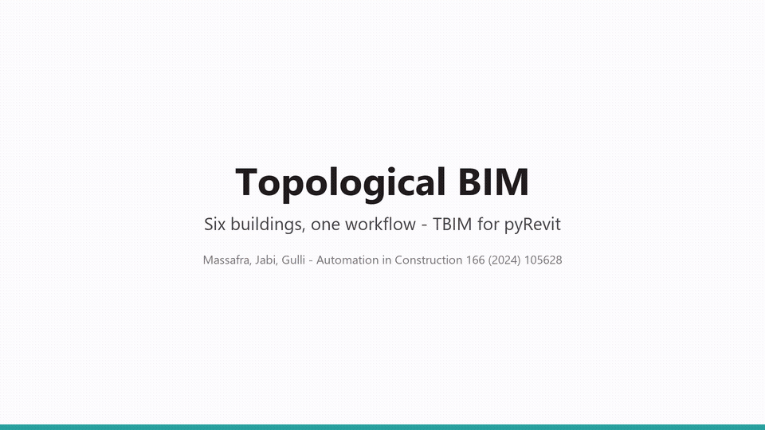
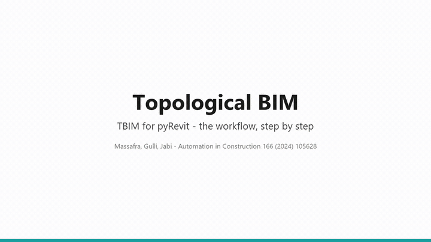

# TBIM - Topological BIM for pyRevit

**Topological BIM (TBIM)** turns a simple 3D massing model into a BIM model rich in the data needed for
building performance management: building storeys, spaces, walls, floors, roofs, windows and doors,
occupancy, internal loads, thermal zones and rule-based element types. The **TBEM** tab then turns the TBIM
into Building Energy Models (Honeybee and EnergyPlus) in three levels of detail, simulates them and maps the
results back on the Revit model.

TBIM is built on [topologicpy](https://github.com/wassimj/topologicpy) (non-manifold topology) and runs in
Autodesk Revit as a [pyRevit](https://github.com/pyrevitlabs/pyRevit) extension. It is the open-source
implementation of:

> A. Massafra, W. Jabi, R. Gulli, *Topological BIM for building performance management*,
> Automation in Construction 166 (2024) 105628. https://doi.org/10.1016/j.autcon.2024.105628



*Six example buildings going through the TBIM and TBEM workflows at the same time: from the massing model to
the BIM model, its thermal zones and the energy simulation ([MP4, 1080p](docs/video/tbim_six_buildings.mp4)).*

## Workflow

| Step | Panel | Result |
|---|---|---|
| 0 | Project | A project folder for the building, linked to the Revit model; **Run** runs the whole workflow, **Check Model** checks it |
| 1 | 3D Model | BRep massing model (one CellComplex per building block) and Project North |
| 2 | Collectors | **Informational Controllers**: storeys, walls, floors, roofs and spaces in Revit |
| 3 | Loads | **Informational Loads**: occupancy (by hand or from a table of rooms), internal loads (ILDs) and thermal zones |
| 4 | Styles | **Informational Styles**: layered Revit types with real materials, from Informational Rule Sets (IRSs) |
| 5 | TopologicalBIM | Windows and doors on the styled CellComplex by rules on the occupancy types, placed in Revit |
| 6 | InstanceBIM | Instance data (areas, finishes, U-values, ...) written back to Revit |
| - | Visualize | Topologic model, dual graph, passage graph (doors, stairs, entrances), element types and any TBIM property in 3D views |
| - | Export | IFC with the TBIM property sets and one `IfcZone` per thermal zone; Topologic models as JSON, BREP, OBJ, dual and passage graphs |

Thermal zones are also Revit **HVAC zones**, so they reach schedules, tags and the IFC export.

## TBEM: from TBIM to energy models

The **TBEM** tab converts the TBIM of the project into a [Honeybee](https://www.ladybug.tools/) model and an
[EnergyPlus](https://energyplus.net) 24.2 model, following the topology-driven BIM-to-BEM conversion of the
DIGITMAN project (TBIM cells → thermal zones → Honeybee rooms → EnergyPlus):

| Panel | Result |
|---|---|
| Project | Same project as the TBIM tab; **Run** builds the three levels and simulates them, **Check Model** checks the inputs |
| Spatial BEM | Thermal zones (TBIM zones, a new clustering or changes by hand, synced with the Revit HVAC zones), programs and schedules by occupancy type: zones as closed volumes with ideal loads |
| Topological BEM | Faces typed by the topology, boundary conditions and inter-zone adjacencies from the CellComplex, windows and doors |
| Full TBEM | Layered constructions of the styles (U-values), glazing, external blinds, context shading, airtightness |
| Energy Simulation | Weather (EPW and design days), settings, IDF, EnergyPlus run in the background, results by zone written to the Revit spaces |
| Visualize | Thermal zones (3D and floor plans), boundary conditions, charts, 3D and 2D maps of any KPI or EnergyPlus output variable with a 10-band color scale |

Every level is a complete model that can be simulated, so the effect of each layer of information can be
compared. See the [TBEM chapter](docs/USER_MANUAL.md#6-tbem-from-tbim-to-bem) of the manual.

The [**User Manual**](docs/USER_MANUAL.md) describes every command and walks through the workflow step by
step on the Demo School.



## Requirements

| | Version tested |
|---|---|
| Autodesk Revit | 2026 |
| pyRevit | 7.0 with the CPython 3.12 engine |
| topologicpy / topologic_core | 0.9.87 / 8.0.4 |
| honeybee-energy, EnergyPlus | 1.126.6, 24.2 (TBEM tab: BIM-to-BEM) |

## Quick start

1. Install [pyRevit](https://github.com/pyrevitlabs/pyRevit/releases) and download this repository
   (e.g. to `C:\tbim`).
2. Install the Python packages for Python 3.12 in a local (not synced) folder:

   ```bat
   py -3.12 -m pip install -r C:\tbim\requirements.txt --target "%LOCALAPPDATA%\tbim\site-packages"
   ```

3. *pyRevit > Settings > Custom Extension Directories*: add `C:\tbim\pyRevit\pyRevit_extensions`, then
   *Reload*.
4. In Revit open the **TBIM** tab and press **Installation > Check**. For the TBEM tab install
   [EnergyPlus 24.2](https://energyplus.net/downloads) (default folder `C:\EnergyPlusV24-2-0`).
5. Follow the [tutorial](docs/USER_MANUAL.md#4-tutorial-the-demo-school-step-by-step), or open an empty model,
   **Project > Open** one of the [example projects](#example-projects) and press **Project > Run**.

## Repository

```text
pyRevit/pyRevit_extensions/TBIM.extension/   the pyRevit extension
  TBIM.tab/                                  ribbon panels and commands of the TBIM workflow
  TBEM.tab/                                  ribbon panels and commands of the BIM-to-BEM workflow
  lib/tbim/                                  TBIM library (topology, loads, styles, apertures, materials, Revit I/O)
  lib/tbem/                                  TBEM library (zones, programs, schedules, Honeybee models, EnergyPlus, results)
templates/json/, templates/bem/              default ILDs, IRSs, tables, programs and schedules of new projects
projects/                                    example projects: inputs, data of every step, Revit, IFC, Topologic, BEM
  Demo_School/                               the tutorial project
  Residential_1960s/                         anonymized 1960s residential case study
  Office_Tower/ School/ Shopping_Centre/     invented buildings generated with tools/building_kit.py
  Fortified_Farmhouse/ Town_Hall/
examples/demo/                               inputs of the tutorial and an offline run without Revit
docs/                                        user manual, images and videos
tests/                                       pytest suite (runs the workflow offline)
tools/                                       building kit of the example projects, TBEM tab generator, icons, videos
legacy/                                      material of the 2023-24 release of this repository (paper data)
```

## Example projects

Every project ships its inputs, the TBIM data of every step (`json/`), the Revit 2026 model at the end of the
workflow (`.rvt`, with the thermal zones as HVAC zones) and its exports (`export/`): IFC4 with the TBIM property
sets and the `IfcZone`s, and the InstanceBIM as topologicpy JSON, BREP, OBJ, dual (adjacency) and passage
graphs. The six buildings of the video also ship their energy models (`bem/`): Honeybee models, EnergyPlus
IDFs and annual results of the three levels, simulated with the weather of Bologna (TMYx 2011-2025 of
[climate.onebuilding.org](https://climate.onebuilding.org)).

| Project | Cells | Windows / doors | |
|---|---|---|---|
| [Demo School](projects/Demo_School) | 9 | 19 | Two-block school of the tutorial, 2 storeys. |
| [Residential 1960s](projects/Residential_1960s) | 112 | 190 | Anonymized residential building of the mid 1960s, reconstructed from archive drawings: 6 storeys, hipped roof. |
| [Office Tower](projects/Office_Tower) | 181 | 480 | 20-storey office tower: concrete core, ring of offices, curtain wall. |
| [School](projects/School) | 23 | 54 | Two-storey school of the 1970s with a gym under a gable roof. |
| [Shopping Centre](projects/Shopping_Centre) | 37 | 76 | Two-level mall: glazed gallery, shops, food court, department store. |
| [Fortified Farmhouse](projects/Fortified_Farmhouse) | 17 | 48 | Fortified farmhouse (*masseria*) of southern Italy around a courtyard, with a tower. |
| [Town Hall](projects/Town_Hall) | 35 | 82 | Early-20th-century town hall: council chamber, hipped roof, clock tower. |

The last five are invented: their `make_model.py` describes the floor plans as rooms with
[`tools/building_kit.py`](tools/building_kit.py), so new test buildings take a few dozen lines.

Except for the Demo School, the walls, floors and roofs of every project are layered Revit types with real
materials, different for each building type: facing-brick cavity walls and clay-tile roofs (1960s housing), a unitised curtain wall and an
inverted flat roof (tower), facing brick, precast panels and a steel-sheet gym roof (school), a ventilated
metal and terracotta facade with a glazed skylight (mall), whitewashed tuff walls on vaulted roof terraces
(farmhouse), rusticated render, exposed brick and lead (town hall). The layers are written in the
Informational Rule Sets (`stFC_Layers`), the U-values are computed from them, and the materials (colour,
conductivity, density, specific heat) come from the material library
[`lib/tbim/materials.py`](pyRevit/pyRevit_extensions/TBIM.extension/lib/tbim/materials.py); each project
README lists its constructions.

## Development

The TBIM library runs outside Revit too: `examples/demo/run_offline.py` executes the whole workflow (the
Revit-side geometry is approximated from the cells), and the tests run it on a copy of the demo. The steps
are functions of `lib/tbim/pipeline.py`, shared by the ribbon commands and Project > Run; the TBEM steps are
in `lib/tbem/pipeline.py` and the TBEM ribbon is generated by `tools/make_tbem_tab.py` (icons:
`tools/make_icons.py`). The tests also build the Honeybee models of the examples and, if EnergyPlus 24.2 is
installed, simulate one.

```bat
py -3.12 -m pip install -r requirements.txt pytest
py -3.12 -m pytest
```

Lint with `ruff check .` (settings in `pyproject.toml`).

## Citation

If you use TBIM in your research, please cite the paper above (see also [`CITATION.cff`](CITATION.cff)).

```bibtex
@article{Massafra2024TBIM,
  title   = {Topological {BIM} for building performance management},
  author  = {Massafra, Angelo and Jabi, Wassim and Gulli, Riccardo},
  journal = {Automation in Construction},
  volume  = {166},
  pages   = {105628},
  year    = {2024},
  doi     = {10.1016/j.autcon.2024.105628}
}
```

## License

[MIT](LICENSE)
