# TBIM for pyRevit - User Manual

**Topological BIM (TBIM)** turns a simple 3D massing model into a BIM model rich in the data needed
for building performance management: building storeys, spaces, walls, floors, roofs, windows and doors,
occupancy, internal loads, thermal zones and rule-based element types. TBIM is built on
[topologicpy](https://github.com/wassimj/topologicpy) (non-manifold topology) and runs in Autodesk Revit
as a [pyRevit](https://github.com/pyrevitlabs/pyRevit) extension.

The method is described in:

> A. Massafra, W. Jabi, R. Gulli, *Topological BIM for building performance management*,
> Automation in Construction 166 (2024) 105628. https://doi.org/10.1016/j.autcon.2024.105628


*The demo project building itself step by step ([MP4, 1080p](video/tbim_selfbuilding.mp4)).*

---

## Contents

1. [Installation](#1-installation)
2. [The TBIM ribbon](#2-the-tbim-ribbon)
3. [Projects](#3-projects)
4. [Tutorial: the Demo School, step by step](#4-tutorial-the-demo-school-step-by-step)
5. [Visualize](#5-visualize)
6. [TBEM: from TBIM to BEM](#6-tbem-from-tbim-to-bem)
7. [Data files](#7-data-files)
8. [Settings and automation](#8-settings-and-automation)
9. [Troubleshooting](#9-troubleshooting)

---

## 1. Installation

**Requirements**

| | Version tested |
|---|---|
| Autodesk Revit | 2026 |
| pyRevit | 7.0 with the CPython 3.12 engine |
| topologicpy / topologic_core | 0.9.87 / 8.0.4 (see `requirements.txt`) |
| honeybee-energy, EnergyPlus | 1.126.6, 24.2 (TBEM tab only) |

**Steps**

1. Install pyRevit and clone (or unzip) this repository, e.g. in `C:\tbim`.
2. Install the Python packages **for Python 3.12** (the version of the pyRevit CPython engine) in a folder
   outside synced folders such as OneDrive:

   ```bat
   py -3.12 -m pip install -r C:\tbim\requirements.txt --target "%LOCALAPPDATA%\tbim\site-packages"
   ```

   Without a local Python 3.12 use `pip install ... --python-version 3.12 --only-binary=:all:`.
   TBIM also looks in `<tbim>\site-packages` and in the `site_packages` folder of `tbim_settings.json`.
3. Add the extension folder to pyRevit: *pyRevit > Settings > Custom Extension Directories* >
   `C:\tbim\pyRevit\pyRevit_extensions`, then *Reload*.
4. In Revit open the **TBIM** tab and press **Installation > Check**: every library must be listed and
   the message must end with *Topologic kernel: ok*. For the TBEM tab it also lists honeybee-energy and
   EnergyPlus 24.2 ([energyplus.net](https://energyplus.net/downloads), default folder `C:\EnergyPlusV24-2-0`).

> Run **Check** again after updating TBIM: the CPython engine keeps the TBIM modules in memory and Check
> reloads them.

---

## 2. The TBIM ribbon

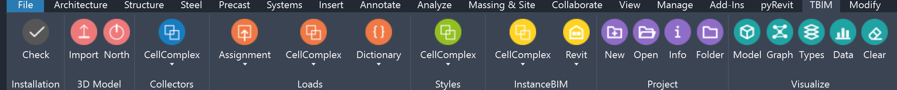

The panels follow the steps of the workflow of the paper, from left to right. Every command has a tooltip:
hover on a button to read what it does.

| | Panel | Command | What it does |
|---|---|---|---|
|  | Project | New | Create a new TBIM project folder (3d/ for the BReps, json/ for the TBIM data) from the templates, make it the active project and link it to the open Revit model. |
|  | Project | Open | Activate an existing TBIM project (or turn any folder into one) and link it to the open Revit model. Linked models activate their project automatically when opened. |
|  | Project | Run | Run the whole workflow on the active project: Collectors (if the model has no TBIM spaces yet), Assignment (table of rooms, or the occupancy types of the spaces), Loads with thermal zones, Styles with layered Revit types, TopologicalBIM (if the project has rules), InstanceBIM and the exports. |
|  | Project | Check Model | Check the project and the Revit model: missing inputs and outputs, faces with holes, cells without occupancy type or room, styles without layers, elements without UID or with the wrong type, duplicated UIDs, spaces not enclosed, apertures without host. |
|  | Project | Info | Show the active project, the project linked to the Revit model and which steps of the TBIM workflow have already produced their data. |
|  | Project | Folder | Open the folder of the active project in Windows Explorer. |
|  | Installation | Check | Check the installation (Python engine, numpy, scipy, topologic_core, topologicpy, data folder; honeybee-energy and EnergyPlus for the TBEM tab) and reload the TBIM and TBEM libraries and topologicpy. Run it after updating TBIM. |
|  | 3D Model | Import | Step 1 - Select the BRep files of the 3D model (one closed CellComplex per building block, in centimetres), e.g. exported from Rhino. |
|  | 3D Model | North | Step 1 - Set the angle of the Project North (degrees, counterclockwise). It is used to compute the exposure of the external faces. |
|  | Collectors | CellComplex > Create | Step 2 - Merge the BReps in a CellComplex and create its Revit counterpart: building storeys (levels), walls, floors, roofs and one space per cell, all tagged with the UID of their cell or face. |
|  | Collectors | CellComplex > Delete | Delete the Informational Controllers of the model (zones, spaces, walls, floors, roofs, levels) to start the workflow again. |
|  | Loads | Assignment > From Table | Step 3 - Assign the occupancy types (and the space names) of all the cells from the table of rooms of the project (`json/tbim_Rooms.json`): each cell takes the room whose point it contains. |
|  | Loads | Assignment > By Building | Step 3 - Assign one occupancy type to all the spaces of the building. |
|  | Loads | Assignment > By Storey | Step 3 - Assign one occupancy type to all the spaces of a building storey. |
|  | Loads | Assignment > By Cell | Step 3 - Assign an occupancy type to the spaces (cells) you select in the model. |
|  | Loads | CellComplex > Update | Step 3 - Copy the ILD of each occupancy type to its cells and faces, compute the exposures and update the Revit spaces. |
|  | Loads | CellComplex > Clusterize | Step 3 - As Update, then cluster the cells in thermal zones (K-Means on the loads, split by storey and adjacency) and write the zone of every space. |
|  | Loads | Dictionary > Read | Show the properties of an Informational Load Dictionary. |
|  | Loads | Dictionary > Create | Create a new Informational Load Dictionary starting from an existing one. |
|  | Loads | Dictionary > Edit | Edit one property of an Informational Load Dictionary. |
|  | Loads | Dictionary > Delete | Delete an Informational Load Dictionary. |
|  | Styles | CellComplex > Update | Step 4 - Apply the Informational Rule Sets (IRSs) to the faces: each face gets the wall, floor or roof type of the matching rules (e.g. by exposure or occupancy). The Revit walls, floors and roofs get these types, built with the layers of `stFC_Layers` (materials with colour and thermal data). |
|  | TopologicalBIM | By Rules | Step 5 - Windows on the external faces and doors between cells, by occupancy type, from `json/tbim_TopologicalBIM_Rules.json`. Writes the TopologicalBIM and places the windows and doors in the walls of their faces (earlier TopologicalBIM apertures are replaced). |
|  | InstanceBIM | CellComplex > Move Apertures | Step 6 - Start the InstanceBIM from the TopologicalBIM, moving the apertures like the windows and doors moved in Revit (movements above 20 cm). |
|  | InstanceBIM | CellComplex > By Occupancy Type | Step 6 - Add to the cells the instance data defined for their occupancy type. |
|  | InstanceBIM | CellComplex > By Table of Spaces | Step 6 - Add to the cells the rows of the table of spaces named in the Name of their Revit space (ids separated by ';'). |
|  | InstanceBIM | CellComplex > By Model | Step 6 - Compute the data measured on the model: gross and net areas and volumes (from the Revit spaces), occupants, ventilation rates. |
|  | InstanceBIM | Revit > Update Data | Step 6 - Write the InstanceBIM data to the Revit spaces, walls, floors, roofs, windows and doors (matched by UID). |
|  | Visualize | Model | Show a Topologic model of the workflow as colored shapes in the 3D view 'TBIM - Topologic model': faces by topological type, windows and doors. Adds a legend. |
|  | Visualize | Dual Graph | Show the dual (adjacency) graph of the cells in the 3D view 'TBIM - Dual graph': one node per cell, one edge per wall or slab shared by two cells. Nodes colored by thermal zone (or occupancy type), edges by kind, with a legend. |
|  | Visualize | Passage Graph | Show the passage graph of the cells in the 3D view 'TBIM - Passage graph': where people can go, through the doors, the stairs (stacked vertical-circulation cells) and the entrances (external doors, to exterior nodes). Nodes colored by thermal zone (or occupancy type), edges by kind, with a legend. |
|  | Visualize | Types | Color walls, floors, roofs, windows and doors by Revit type in the 3D view 'TBIM - Element types', with a legend. |
|  | Visualize | Data | Color cells, faces or apertures by a TBIM property (e.g. thermal zone, occupancy type, exposure) in a dedicated 3D view, with a legend. |
|  | Visualize | Clear | Delete all the TBIM visualizations: shapes, 'TBIM - ' views and legends. |
|  | Export | IFC | Export the Revit model to IFC (IFC4 RV/DTV, IFC2x3 CV2, IFC4x3) in `<project>/export`, with the TBIM parameters as property sets, base quantities and space boundaries. |
|  | Export | Topologic | Export a Topologic model of the workflow to `<project>/export`: topologicpy JSON (geometry, dictionaries, apertures), BREP, OBJ, or the dual and passage graphs of the cells as JSON. |

---

## 3. Projects

Each TBIM project lives in its own folder, so that different buildings never mix their data:

```text
<tbim>/projects/<name>/
  project.json     name, creation date, description
  3d/              BRep files of the building blocks
  json/            TBIM data: ILDs, IRSs, tables, CellComplex models, log
```

| Command | |
|---|---|
| **Project > New** | Creates `<tbim>/projects/<name>/`, copies the default ILDs, IRSs and tables of `<tbim>/templates/json`, makes it the active project and links it to the open Revit model. |
| **Project > Open** | Activates a project of the projects folder, or any other folder (*Browse...*), which becomes a project. |
| **Project > Run** | Runs every step of the workflow on the active project, with a progress report (see below). |
| **Project > Check Model** | Lists the problems of the project and of the Revit model (errors, warnings). |
| **Project > Info** | Shows the active project, the project linked to the model and which steps already produced their data. |
| **Project > Folder** | Opens the project folder. |

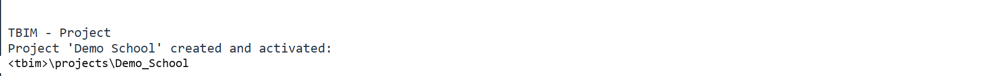

The project folder is stored in the **Project Information** of the Revit model (parameter
`tbim_ProjectFolder`; relative to the TBIM folder when inside it, e.g. `projects/School`): when you open a
linked model, TBIM activates its project automatically.
BRep paths inside the project folder are stored relative to it, so a project can be moved or shared.

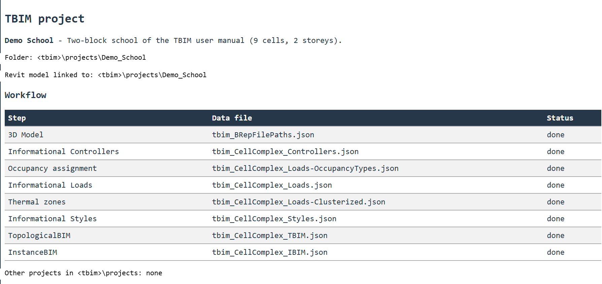

The projects folder is `<tbim>/projects` unless `projects_root` is set in `tbim_settings.json`
(see [Settings](#8-settings-and-automation)).

**Project > Run** chains the commands of the ribbon, so that a project with all its inputs becomes a complete
Revit model with one click: Collectors > Create (if the model has no TBIM spaces yet), Loads > Assignment >
From Table (if the project has `tbim_Rooms.json`; otherwise the occupancy types already given to the spaces),
Loads > Clusterize, Styles > Update, TopologicalBIM > By Rules (if the project has
`tbim_TopologicalBIM_Rules.json`), the InstanceBIM steps and, optionally, the exports. Each command can still
be run on its own, e.g. to repeat a step after changing its inputs. Every command first activates the project
linked to the open Revit model, so it never writes to the project of another model.

**Project > Check Model** then reports what is missing or inconsistent: inputs and outputs of the steps, cells
without occupancy type or room, styles without layers, elements without `UID` or with a type other than their
style, duplicated UIDs, spaces not enclosed (area 0) and apertures without host.

### Example projects

The repository ships seven complete projects. Each one has its inputs, the TBIM data of every step (`json/`),
the Revit 2026 model at the end of the workflow (thermal zones as HVAC zones) and its exports (`export/`: IFC
with the `IfcZone`s and Topologic models); the six buildings of the video also ship their energy models and
results (`bem/`, see [TBEM](#6-tbem-from-tbim-to-bem)). Open the
`.rvt` to explore the result, or start from an empty model, **Project > Open** the folder and press
**Project > Run** (a few minutes for the largest buildings). Each `.rvt` is linked to its folder relative to
the TBIM folder (`projects/<name>`), so opening it activates its project wherever the repository is cloned.

| Project | Cells | |
|---|---|---|
| [`Demo_School`](../projects/Demo_School) | 9 | The school of the [tutorial](#4-tutorial-the-demo-school-step-by-step), at the end of step 6. |
| [`Residential_1960s`](../projects/Residential_1960s) | 112 | An anonymized 1960s residential building reconstructed from archive drawings ([README](../projects/Residential_1960s/README.md), [video](../projects/Residential_1960s/video/tbim_residential_1960s.mp4)). |
| [`Office_Tower`](../projects/Office_Tower) | 181 | Invented 20-storey office tower. |
| [`School`](../projects/School) | 23 | Invented two-storey school with a gym. |
| [`Shopping_Centre`](../projects/Shopping_Centre) | 37 | Invented two-level shopping centre. |
| [`Fortified_Farmhouse`](../projects/Fortified_Farmhouse) | 17 | Invented fortified farmhouse (*masseria*) around a courtyard. |
| [`Town_Hall`](../projects/Town_Hall) | 35 | Invented town hall with a clock tower. |


The invented buildings are written with `tools/building_kit.py`: a `make_model.py` lists the rooms of each
storey as boxes (plus attics under hipped or gable roofs) with their occupancy type, and the ILDs, InstanceBIM
data, IRSs and window/door rules; running it writes the BReps and all the JSON inputs of the project,
including the table of rooms (`tbim_Rooms.json`, for Loads > Assignment > From Table) and the window/door rules
(`tbim_TopologicalBIM_Rules.json`, for TopologicalBIM > By Rules).

Each IRS rule of the examples carries a layered construction in `stFC_Layers` (e.g. `Clay roof tiles 20 mm /
Timber battens 30 mm / ...`, from the outside or the top). The material library of TBIM (`lib/tbim/materials.py`)
holds the materials (colour, thermal conductivity, density, specific heat, Revit layer function) and computes
the U-value of each rule; Styles > Update turns every style into a Revit compound structure with these
materials, so the Revit types, the IFC material layer sets and the TBIM data describe the same construction.

---

## 4. Tutorial: the Demo School, step by step

The tutorial reproduces the workflow of the paper on the **Demo School**, an anonymized two-block school:
block A has two storeys with three rooms and a corridor per floor, block B is a single-storey gym.
All its inputs are in `examples/demo` (`3d/BlockA.brep`, `3d/BlockB.brep`, `json/`).

Start from an empty Revit project (e.g. the default architectural template).

### Step 0 - Create the project

1. **Project > New**, name *Demo School*.
2. Copy `examples/demo/3d/BlockA.brep` and `BlockB.brep` in the `3d` folder of the new project
   (**Project > Folder** opens it), and from `examples/demo/json` to its `json` folder:
   `tbim_InstanceBIM_byTableOfSpaces.json` (the table of spaces, the design brief of the building),
   `tbim_Rooms.json` (the rooms, for step 3) and `tbim_TopologicalBIM_Rules.json` (windows and doors, for
   step 5).

> The [`projects/Demo_School`](../projects/Demo_School) folder holds the same project already complete: open it
> with **Project > Open** on an empty model and press **Project > Run** to get the result of every step at once.

### Step 1 - 3D Model

The 3D model is made of closed **building blocks**, one BRep per block, each one a cluster of cells
(rooms or groups of rooms) modelled in centimetres, e.g. in Rhino.

1. **3D Model > Import**: select the two BReps.
2. **3D Model > North**: `15` degrees (the Project North of the demo).

### Step 2 - Informational Controllers

**Collectors > CellComplex > Create** merges the blocks in a single Topologic **CellComplex** and creates
its Revit counterpart:

- one **level** per distinct elevation (`BuildingStorey_0cm`, `BuildingStorey_300cm`, `BuildingStorey_600cm`;
  unused template levels are deleted);
- one **wall** per vertical face, one **floor** per horizontal face, one **roof** per top face;
- one **space** per cell.

Every element stores the `UID` of its cell or face (e.g. `Cell3`, `extVerFace12`): this is the link that
lets the next steps update the Revit model.

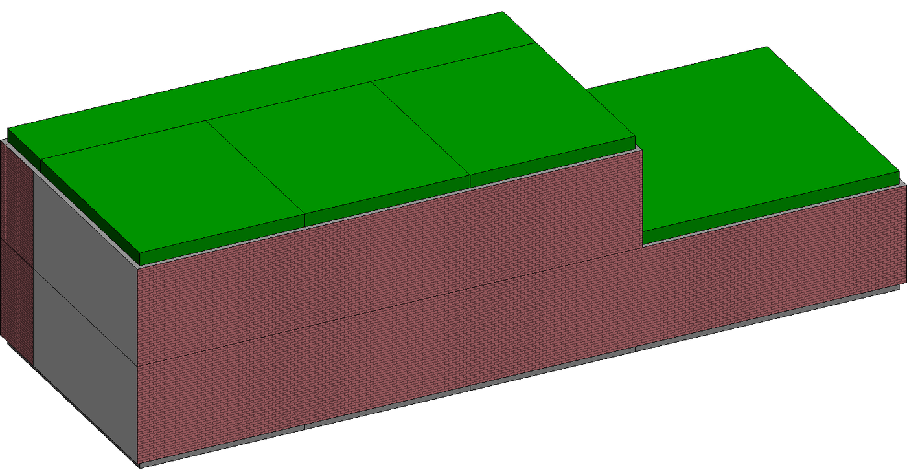

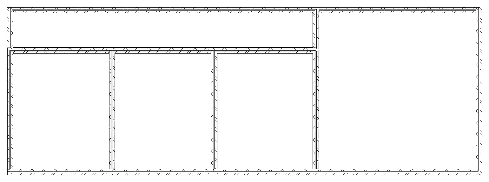

**Visualize > Model** shows the CellComplex itself, with the faces colored by topological type
(external/internal, vertical/horizontal; external faces are see-through):

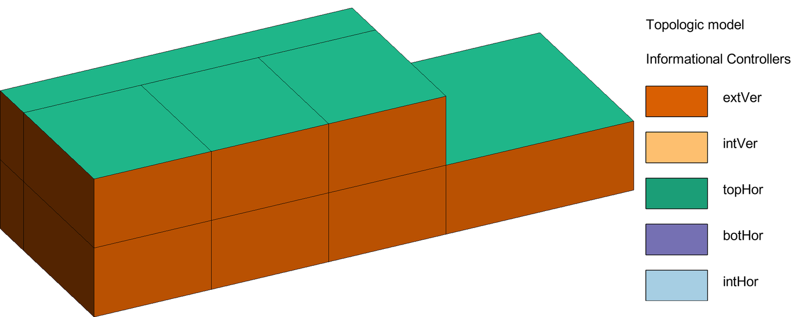

### Step 3 - Informational Loads

1. Assign an **occupancy type** to every space with **Loads > Assignment** (*From Table*, *By Building*,
   *By Storey* or *By Cell*). Each occupancy type is an **Informational Load Dictionary (ILD)**, a set of
   properties such as heating, cooling, ventilation and occupancy density (**Loads > Dictionary** to read,
   create and edit them). In the demo: two classrooms, two offices, a meeting room, a storage, two corridors
   and a gym.

   **From Table** does it for all the cells at once from `tbim_Rooms.json`, a list of rooms with a point
   inside each of them (cm): every cell takes the room whose point it contains, and its Revit space is named
   after the room's `space` ids (the key of InstanceBIM > By Table of Spaces, step 6).

   ```json
   [{"center": [250, 300, 150], "pr_OccupancyType": "Education:Classroom", "space": "A0.01", "name": "A0-R1"}]
   ```
2. **Loads > CellComplex > Clusterize** copies the ILDs to the cells and faces, computes the exposure of the
   external faces and groups the cells in **thermal zones**:
   - classrooms are zones on their own;
   - corridors (public circulation) are grouped by connected components;
   - the other cells are clustered with K-Means on their loads and split in connected groups;
   - support spaces (e.g. storage) join the adjacent zone of the same storey;
   - zones never span storeys and are named `Zone<i>_BS<elevation>`.

   Each space gets its zone in `rl_HasLocation_tpZN`, and every thermal zone becomes a Revit **HVAC zone** with
   its spaces (same name, `IfcName` set), so the IFC export writes one `IfcZone` per thermal zone, grouping its
   `IfcSpace`s. *Update* does the same without the zoning.

The demo gets 8 thermal zones for 9 cells (the meeting room and the storage share a zone):

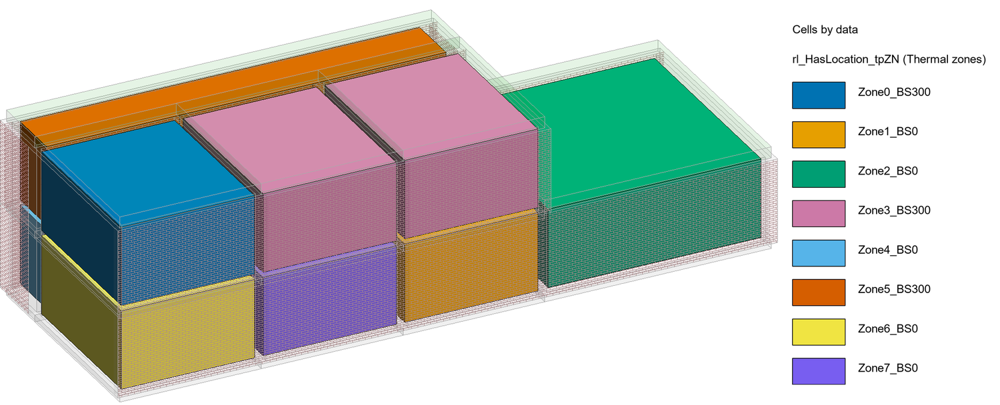

**Visualize > Dual Graph** draws the **dual (adjacency) graph** of the cells: one node per cell, one edge per
shared wall or slab.

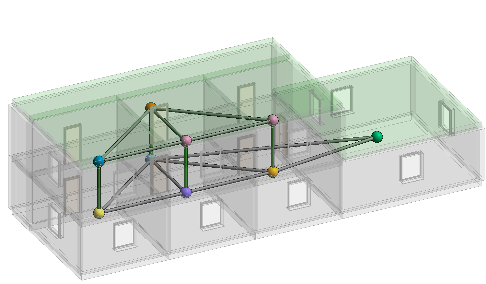

### Step 4 - Informational Styles

**Styles > CellComplex > Update** applies the **Informational Rule Sets (IRSs)**, one file per face type.
A rule has conditions (`cnFC_<operator>_<property>`) and styles (`stFC_<style>`); the rules are applied in
order and a later matching rule overrides the styles of an earlier one. For example, the internal walls of
the demo are partitions, unless they face a corridor or separate the two blocks:

```json
[
  {"cnFC_equalTo_pr_TopologicalType": "intVer", "stFC_WallTypeName": "TBIM_Partition_100"},
  {"cnFC_equalTo_pr_TopologicalType": "intVer", "cnFC_contains_pr_OccupancyType": "Circulation:Corridor",
   "stFC_WallTypeName": "TBIM_CorridorWall_150"},
  {"cnFC_equalTo_pr_TopologicalType": "intVer", "cnFC_contains_rl_HasLocation_tpBB": "BlockA-BlockB",
   "stFC_WallTypeName": "TBIM_FireWall_250"}
]
```

Operators (case insensitive): `equalTo`, `notEqualTo`, `contains`, `isContained`, `majorOf`, `minorOf`.
A rule with a property that the face does not have never matches. In the demo the south-facing external walls get a thicker type with shading devices.

A rule can also describe the construction of its type in `stFC_Layers`, from the outside (or the top) to the
inside, with the materials of the TBIM material library and their thicknesses, e.g.
`"Facing brick 60 mm / EPS insulation 30 mm / Perforated clay brick 250 mm / Lime-cement plaster 15 mm"`.
Styles > Update then gives the Revit walls, floors and roofs the type of their style. A type the model does
not have yet is created: with the layers of `stFC_Layers`, materials and thermal assets included (so Revit
computes the U-value of the type too), or, without layers, with one structure layer as thick as the number
ending its name (`TBIM_Partition_100`: 100 mm), as in the demo. Existing types are used as they are.

### Step 5 - TopologicalBIM

The TopologicalBIM adds **windows and doors** (apertures) to the styled CellComplex and builds the BIM
model with the element types of the styles. **TopologicalBIM > By Rules** reads them from
`tbim_TopologicalBIM_Rules.json`, by occupancy type:

```json
{"windows": [["Circulation", null], ["", "TBIM_Window_120x150", 120, 150, 90]],
 "doors":   [["Corridor", "Corridor", null], ["Corridor", "", "TBIM_Door_90x210", 90, 210]]}
```

- `windows`: `[occupancy contains, type, width, height, sill]`, one window centred on each external wall of
  the cell;
- `doors`: `[occupancy A contains, occupancy B contains, type, width, height]`, one door between each pair of
  adjacent cells;
- `external_doors`: `[occupancy contains, type, width, height]`, one entrance per cell on the walls at the
  `entrance_levels` (z in cm, default `[0]`).

The first matching rule wins, and a rule with a `null` type places nothing: put the exceptions first (above,
no windows in the circulation spaces, no doors between two corridors). An empty occupancy matches every cell;
sizes are in centimetres. A face too narrow or too low for its aperture gets none. `window_data` and
`door_data` add properties to every window or door (e.g. `pr_ThermalTransmittance`). The windows and doors
are then placed in Revit, in the walls of their faces, with types of the given sizes (created if missing).
Running By Rules again replaces the apertures it placed before.

The demo gets 12 windows on the external walls of the occupied rooms and 7 doors towards the corridors (and
between the corridor and the gym).

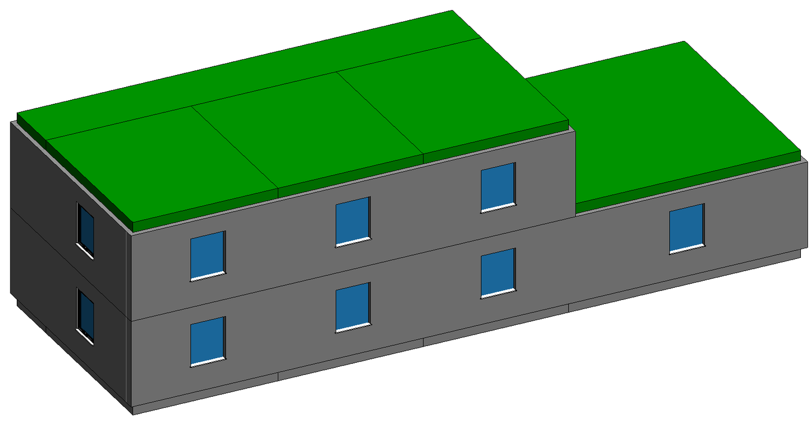

**Visualize > Types** colors every element by its Revit type:

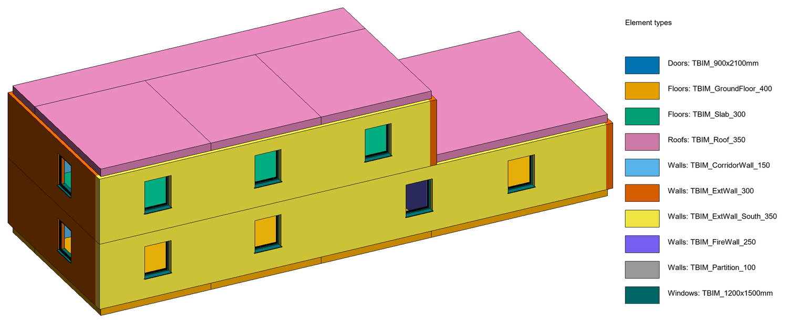

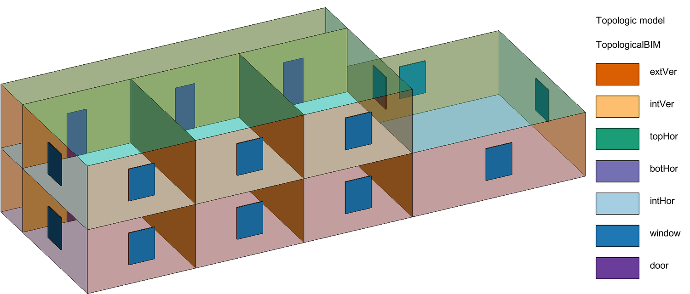

### Step 6 - InstanceBIM

The designer now develops the model in Revit, as usual: for example, the window of the ground-floor office
is moved by 1.86 m. The spaces carry the ids of their rows of the table of spaces in their name (`A0.01`, ...,
`A0.04a; A0.04b` for the corridor that groups two rows): Loads > Assignment > From Table wrote them in step 3,
otherwise type them in the space names. The **InstanceBIM** brings these changes and the instance data back
into the topological model, then into Revit:

1. **Move Apertures**: windows and doors moved in Revit by more than 20 cm are moved in the TBIM too.
2. **By Occupancy Type**: data defined per occupancy type (`tbim_InstanceBIM_byOccupancyType.json`:
   occupancy densities, ventilation rates, set-point temperatures).
3. **By Table of Spaces**: the rows of the table of spaces named in each space (areas, finishes, ...;
   numbers are summed, texts joined).
4. **By Model**: gross areas and volumes from the CellComplex, net areas and volumes measured on the Revit
   spaces (they win over the table), occupants and ventilation rates.
5. **Revit > Update Data**: everything is written to the spaces, walls, floors, roofs, windows and doors
   (9 spaces, 43 walls/floors/roofs and 19 windows/doors in the demo).

Every Revit element now carries its TBIM data, e.g. the exposure of the faces:

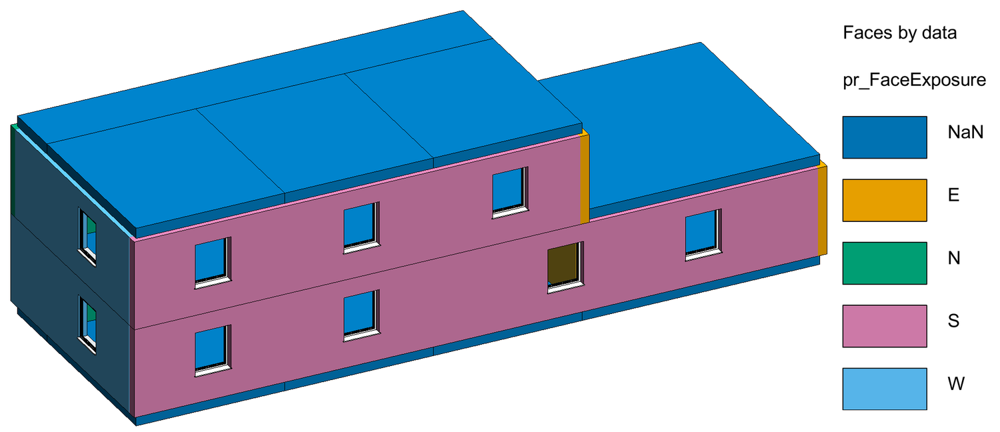

**Visualize > Passage Graph** shows where people can go: one edge per **door** between two cells, per
**stair** (the slab between two stacked vertical-circulation cells: stairs, lifts, cores, ramps) and per
**entrance** (an external door, linked to an *Exterior* node just outside it). Unlike the dual graph, two
rooms sharing a wall without a door are not connected; the demo has no stair cell and no entrance rule, so
its two storeys are two separate groups of rooms around their corridors:

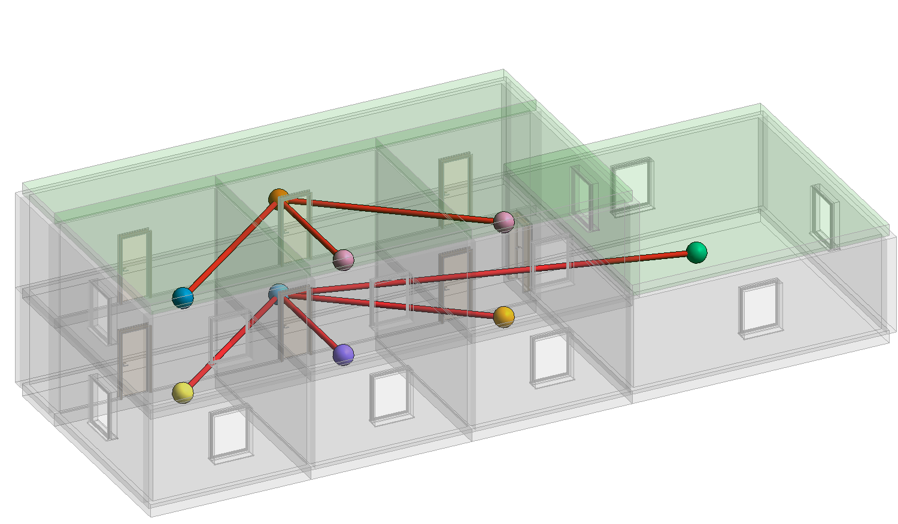

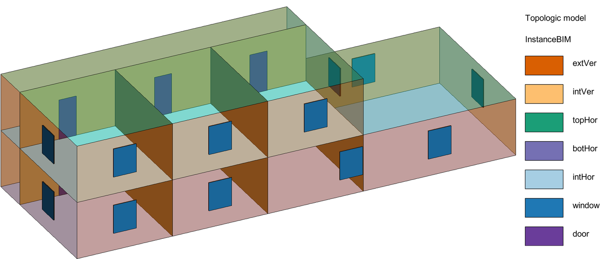

---

## 5. Visualize

The **Visualize** panel shows the topological models and the TBIM data inside Revit. Each command creates
(or updates) a dedicated 3D view and a legend drafting view:

| Command | 3D view | Legend view |
|---|---|---|
| Model | `TBIM - Topologic model` | `TBIM Legend - Topologic model` |
| Dual Graph | `TBIM - Dual graph` | `TBIM Legend - Dual graph` |
| Passage Graph | `TBIM - Passage graph` | `TBIM Legend - Passage graph` |
| Types | `TBIM - Element types` | `TBIM Legend - Element types` |
| Data | `TBIM - Cells by data`, `TBIM - Faces by data`, `TBIM - Apertures by data` | `TBIM Legend - ...` |

- Topologic models and graphs are DirectShapes (Generic Models) colored with `TBIM #RRGGBB` materials; each
  view shows only its own shapes.
- Types and Data color the Revit elements with view overrides, so the model itself is not changed.
- Data: numeric properties with many values are split in classes of a sequential palette, the others get
  categorical colors.
- **Clear** deletes all the shapes, views and legends.

Place a legend next to its view on a sheet to document the model.

---

## 6. TBEM: from TBIM to BEM

The **TBEM** tab turns the TBIM of the active project into a Building Energy Model (BEM): a
[Honeybee](https://www.ladybug.tools/) model and an [EnergyPlus](https://energyplus.net) 24.2 model. It
follows the BIM-to-BEM conversion of the DIGITMAN project (*Topology-Driven BIM-to-BEM for Occupancy-Based
Energy Scenario Analysis in Higher-Education Buildings*, Massafra et al.): TBIM cells → thermal zones →
Honeybee rooms → EnergyPlus. The source is the most complete TBIM model of the project (InstanceBIM, else
TopologicalBIM, Styles or the clusterized Loads).

The model is built in three levels of detail, one panel each; every level is a complete model that can be
simulated, so the effect of each layer of information can be compared. The **Project** panel works as in the
TBIM tab: the project is the same, and its TBEM files are in its `bem` folder.

| Panel | Command | What it does |
|---|---|---|
| Project | New / Open | Same as in the TBIM tab: create or activate the project and link it to the Revit model |
| | Run | Build the three levels, then run EnergyPlus on all of them, on the Full TBEM only or on none (waiting for the results) |
| | Check Model | TBIM model, programs, schedules, constructions, shading files, weather file and EnergyPlus |
| | Info | Active project, link with the Revit model, models, IDFs, simulations and results of each level |
| | Folder | The `bem` folder of the project |
| Spatial BEM | Zones > Clusterize / From TBIM | Thermal zones: a new clustering with the TBEM settings, or the zones of Loads > Clusterize. Every change of the zones (also Merge / Exclude / Include) updates the Revit HVAC zones, hence the `IfcZone`s |
| | Zones > Merge / Exclude / Include Selected | Change the zones of the selected Revit spaces, or leave them out of the model |
| | Programs > Check / Edit | Energy data by occupancy type (`tbem_Programs.json`) |
| | Schedules > Import / Check | Library of schedules (`tbem_Schedules.json`, Honeybee ScheduleRuleset JSON) |
| | Build | **Spatial BEM**: zones as closed volumes, programs, ideal loads; Honeybee face types and default constructions, no apertures |
| Topological BEM | Boundaries > Adiabatic / Ground / Outdoors / Reset | Boundary condition of the selected walls, floors, roofs |
| | Build | **Topological BEM**: faces typed by the topology, inter-zone adjacencies from the shared faces, windows and external doors |
| Full TBEM | Constructions | Layered constructions of the styles (U-values) and glazing of the windows |
| | Shading > Import / Clear | Context shading (BRep, cm) |
| | Infiltration | Building airtightness |
| | Build | **Full TBEM**: constructions from `stFC_Layers`, simple glazing, external blinds, context shading |
| Energy Simulation | Weather | EPW file (and a `.ddy` with the same name for the design days) |
| | Settings | `tbem_Settings.json` in the default editor |
| | IDF / Run | Export a level to EnergyPlus; Run also starts EnergyPlus in the background |
| | Results > Summary / Write to Spaces | Annual end uses by zone (kWh, kWh/m²), `rs_` parameters on the spaces |
| Visualize | Zones > 3D Map / 2D Map | Grouping of the spaces in thermal zones: cells colored by zone in a 3D view, or a floor plan per storey with the spaces filled by zone, the zone names and the zones of the storey in the legend |
| | Boundaries | 3D view: walls, floors and roofs colored by boundary condition |
| | Charts | pyRevit output: end uses by month, heating and cooling need by zone, the simulated levels compared |
| | 3D Map | Cells colored by a KPI (heating, cooling, lighting, equipment need, mean air temperature) or by any zone output variable of the run (annual kWh and kWh/m² of the energies, annual mean and maximum of the others), with a 10-band color scale |
| | 2D Map | A floor plan per storey: spaces filled by the same KPIs or output variables, the value in each space and the 10-band color scale |
| | Clear | Delete the TBEM shapes, the `TBIM - BEM ...` views and their legends |

**Thermal zones.** The zones of the energy model are the thermal zones of the TBIM (Loads > Clusterize):
classrooms on their own, public circulation and support spaces grouped by adjacency, the other cells clustered
with K-Means on their loads and split by adjacency, never across storeys (see
[step 3 of the tutorial](#4-tutorial-the-demo-school-step-by-step)). **Zones > Clusterize** clusters again with
the settings of `tbem_Settings.json` (`zoning`: `n_clusters`, `kmeans_property_names`,
`single_zone_occupancy_types`, `excluded_occupancy_types`); **Merge / Exclude / Include Selected** change the
zones of the spaces selected in Revit (saved in `tbem_Zones.json`); **From TBIM** goes back to the TBIM zones.
Every thermal zone is also a Revit **HVAC zone** with its spaces (on the level of its spaces, named as the
zone, with `IfcName` set): the IFC export writes one `IfcZone` per thermal zone grouping its `IfcSpace`s, and
Revit schedules and tags can use the zones. Loads > Clusterize creates them, every zone change in the TBEM tab
updates them; spaces left out of the energy model go back to the default zone. **Visualize > Zones > 3D Map /
2D Map** show the grouping.

**From the cells to the zones.** Each cell takes its energy data from its own properties (the InstanceBIM
values win) and, for what is missing, from the program of its occupancy type: the occupancy type itself
(`Education:Classroom`), its category (`Education`) or `Default`. Zone values are aggregated as in DIGITMAN:
densities weighted by area, air changes by volume, outdoor air per person by occupants; a zone is heated or
cooled if any of its cells is; the heating set-point is the highest, the cooling set-point the lowest;
occupancy type and schedules are those of the most occupied cell.

| Cell property | Unit | BEM |
|---|---|---|
| `pr_OccupancyDensityOperation` (else 1 / `pr_AreaPerOccupantPeak`) | people/m² | People |
| `pr_LightingPowerDensity`, `pr_EquipmentPowerDensity` | W/m² | Lights, ElectricEquipment |
| `pr_SpaceTemperatureWinterMin`, `pr_SpaceTemperatureSummerMax` | °C | heating and cooling set-points |
| `pr_HumidityMin`, `pr_HumidityMax` (optional) | % | humidifying and dehumidifying set-points |
| `pr_MechanicalVentilationRatePerPerson` (mechanical ventilation) | L/s per person | outdoor air of the ideal loads |
| `pr_MechanicalVentilationRate` / `pr_NaturalVentilationRate` (no rate per person) | 1/h | outdoor air (air changes) |
| `pr_IsHeated`, `pr_IsCooled` | | ideal loads air system and its availability |
| `rl_IsScheduledBy_<use>` | | schedules: Occupancy, Lighting, Equipment, Heating, Cooling, Ventilation |

**Faces.** A face of the CellComplex between cells of different zones becomes an inter-zone surface in both
rooms; a face between cells of the same zone is not modelled; a face towards a cell left out of the model is
adiabatic. In the Topological BEM `botHor` faces are on the ground and external faces outdoors, unless set
otherwise with Boundaries. Layers (`stFC_Layers`) run from the outside, or the top, to the inside: floors and
the second side of internal walls get the reversed construction (`..._Rev`). Walls whose layers include
glazing (curtain walls) get windows by ratio (`glazed_wall_ratio`).

**Simulation.** EnergyPlus 24.2 (`C:\EnergyPlusV24-2-0`, or `energyplus_folder` in the settings) runs in
`%LOCALAPPDATA%\tbim\energyplus\<project>\<level>`, outside synced folders (its post-processor fails on
non-ASCII paths), while Revit stays usable; **Results > Summary** copies the outputs to
`bem/simulation/<level>` when the run is over. Ground temperatures come from the EPW. Without design days the
ideal loads have no capacity limit.

| File (`bem` folder) | Content |
|---|---|
| `tbem_Settings.json` | Zoning, boundary conditions, apertures, glazing, blinds, shades, infiltration, HVAC, simulation |
| `tbem_Programs.json`, `tbem_Schedules.json` | Programs and schedules (copied from `templates/bem` the first time) |
| `tbem_Zones.json` | Zones changed in the TBEM tab (`{cell UID: zone}`, `null` = not modelled) |
| `tbem_<level>.hbjson`, `tbem_<level>_Zones.json` | Honeybee model; cells, floor area and volume of its zones |
| `tbem_<level>.idf`, `tbem_<level>_Results.json` | EnergyPlus model; annual results by zone, monthly end uses of the building and every zone output variable summarised (`metrics`) |
| `tbem_<level>_Charts.html` | The charts of Visualize > Charts as a standalone page (SVG) |
| `weather/`, `shades/`, `simulation/<level>/` | EPW and DDY files, shading BReps, EnergyPlus outputs (not kept in git) |

**Visualize.** The TBEM views are named `TBIM - BEM ...` (3D views and floor plans), their legends
`TBIM Legend - BEM ...`; **Clear** deletes them. **Zones > 2D Map** draws a floor plan per storey with the
spaces filled by thermal zone and the zone name in each space (the School of the examples: the gym with its
changing rooms and store is one zone, the entrance hall with the corridor and the stair another):

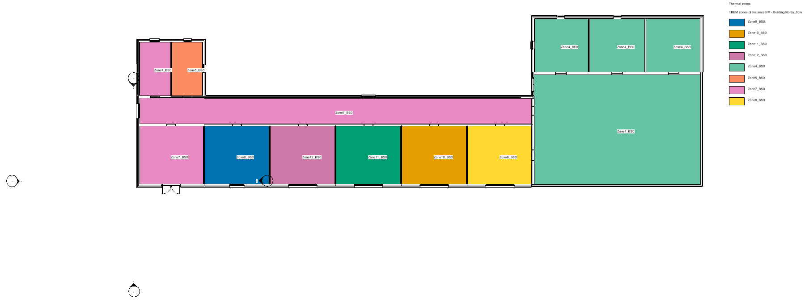

**3D Map** and **2D Map** map a KPI (heating, cooling, lighting and equipment need in kWh/m² y, mean air
temperature) or any zone output variable of the run: the energies as annual kWh and kWh/m², the other
variables (operative temperature, occupant count, ...) as annual mean and maximum. The values are split in 10
equal bands from pale yellow to dark red; the cells left out of the model are grey. Cooling need of the School
in Bologna, south-facing classrooms first:

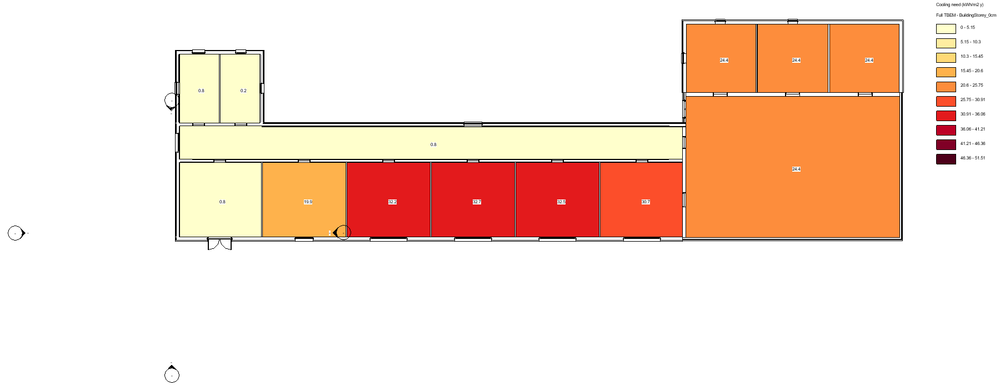

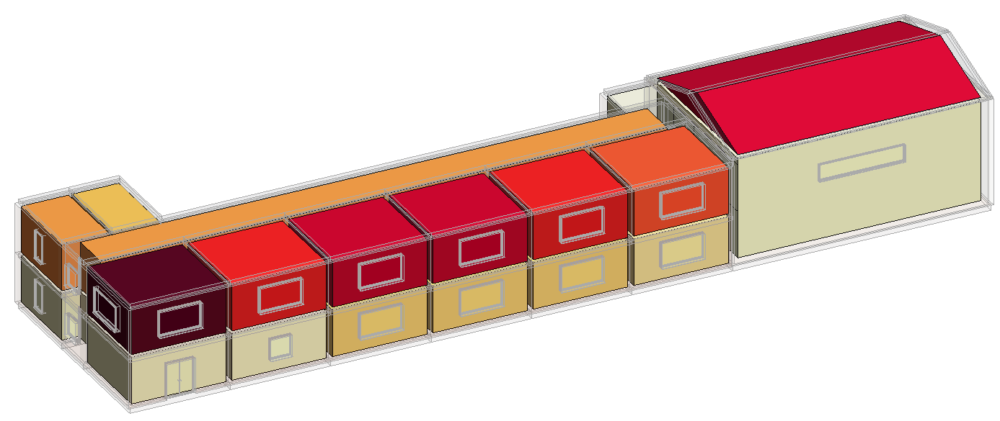

**Charts** shows, in the pyRevit output and in `bem/tbem_<level>_Charts.html`, the annual end uses, the end
uses by month, the heating and cooling need by zone and the simulated levels compared:

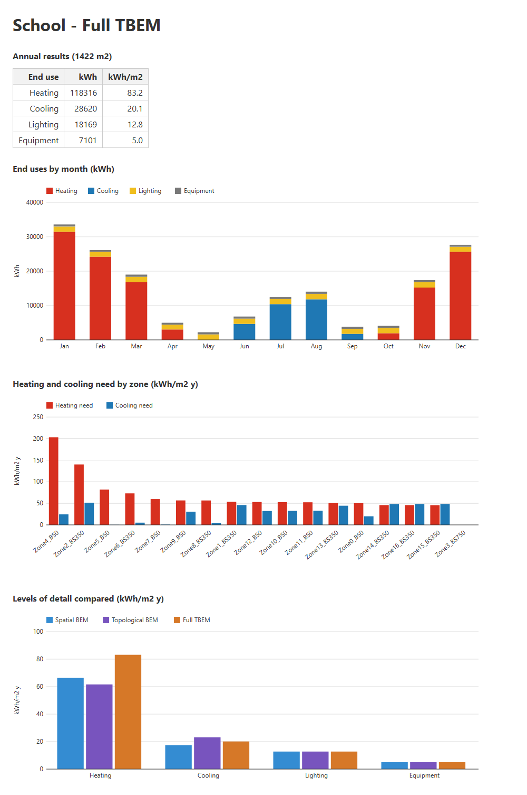

The schedule files of digitman_bim2bem (e.g. the occupancy schedules of the university booking service) can
be added to the library with **Schedules > Import**: the use in the file name sets the identifier prefix
(`OccSch_`, `LghSch_`, `EqpSch_`, `HtnSch_`, `ClnSch_`, `VntSch_`). The default library has neutral weekly
profiles by category, with the heating season 15 October - 15 April and the cooling season 1 June -
15 September.

---

## 7. Data files

All the files are in the `json` folder of the project (the *data folder*).

| File | Written by | Content |
|---|---|---|
| `tbim_BRepFilePaths.json` | Import | BRep paths (relative to the project) |
| `tbim_ProjectNorthAngle.json` | North | Project North angle (degrees) |
| `tbim_ILDs.json` | Dictionary | Informational Load Dictionaries |
| `tbim_IRS_<face type>Faces.json` | (input) | Informational Rule Sets |
| `tbim_InstanceBIM_byOccupancyType.json` | (input) | Instance data per occupancy type |
| `tbim_InstanceBIM_byTableOfSpaces.json` | (input) | Table of spaces (design brief) |
| `tbim_Rooms.json` | (input) | Rooms: a point inside each one, occupancy type, space ids, name (Assignment > From Table) |
| `tbim_TopologicalBIM_Rules.json` | (input) | Windows and doors by occupancy type (TopologicalBIM > By Rules) |
| `tbim_CellComplex_Controllers.json` | Collectors > Create | CellComplex with cell and face UIDs |
| `tbim_CellComplex_Loads-OccupancyTypes.json` | Assignment | Occupancy type of every cell |
| `tbim_CellComplex_Loads.json` | Loads > Update / Clusterize | CellComplex with the loads |
| `tbim_CellComplex_Loads-Clusterized.json` | Loads > Clusterize | ... and the thermal zones |
| `tbim__FaceProperties.json` | Loads | Face properties available to the IRSs |
| `tbim_CellComplex_Styles.json` | Styles > Update | CellComplex with the styles |
| `tbim_CellComplex_TBIM.json`, `..._TBIM_AperturesLocation.json` | TopologicalBIM | TBIM with apertures, aperture locations |
| `tbim_CellComplex_IBIM.json` | InstanceBIM | InstanceBIM |
| `tbim.log` | all | Messages, when dialogs are off |

The **Export** commands write to the `export` folder of the project (next to `json`): `<model>.ifc`, and
`tbim_<model>.json/.brep/.obj`, `tbim_<model>_adjacency_graph.json` (the dual graph: edges of kind `wall` or
`slab`) and `tbim_<model>_passage_graph.json` (edges of kind `door`, `stair` or `entrance`, plus the
*Exterior* nodes). The graph files list the nodes with the cell properties and their coordinates in
centimetres.

CellComplex files are topologicpy JSON exports: open them with `Topology.ByJSONPath` or with
`tbim.topo.load_cellcomplex`, which also restores the cell and face dictionaries.

Property names follow the paper: `pr_` properties (e.g. `pr_OccupancyType`, `pr_NetArea`),
`rl_HasLocation_tp..` relationships (`tpBB` building block, `tpBS` building storey, `tpZN` thermal zone,
`tpSP` table-of-spaces ids, `inFC` host face of an aperture), `st..` styles.

---

## 8. Settings and automation

`<tbim>/tbim_settings.json` (created by Project > New/Open, optional otherwise):

| Key | Default | |
|---|---|---|
| `data_dir` | `json` | Data folder (absolute or relative to `<tbim>`); set by Project > New/Open. |
| `projects_root` | `projects` | Folder of the projects. |
| `site_packages` | - | Extra folder with topologicpy and topologic_core. |
| `dialogs` | `true` | `false`: no dialogs, messages go to `<data folder>/tbim.log` (batch runs, tests). |
| `choices` | `{}` | Answers used when `dialogs` is `false`, e.g. `{"visualize_model": "InstanceBIM", "visualize_data_property": "pr_FaceExposure"}`. TBEM: `tbem_weather_file` (EPW path), `tbem_run_workflow`, `tbem_results_level` (e.g. `Full TBEM`), `tbem_result` (a KPI or output variable label, e.g. `Cooling need (kWh/m2 y)`). |

Inside Revit, **Project > Run** runs the whole workflow with the answers of `choices` (e.g. `run_workflow`,
whether to export at the end). Outside Revit, `examples/demo/run_offline.py` runs it with the Revit-side
geometry approximated from the cells, and the test suite (`pytest`) runs it on a copy of the demo. The steps
are the functions of `lib/tbim/pipeline.py`, which the commands, Run and the offline demo share.

---

## 9. Troubleshooting

| Problem | Solution |
|---|---|
| *topologic_core NOT AVAILABLE* in Check | Install the packages for Python 3.12 (see [Installation](#1-installation)); since topologicpy 0.9 `topologic_core` must be installed explicitly. |
| A change to the TBIM code has no effect | Run **Installation > Check** (it reloads the TBIM modules) or restart Revit. |
| Commands do nothing and nothing is logged | With `"dialogs": false` messages go to `tbim.log`; with `true` a dialog may be waiting behind another window. |
| Walls/floors/roofs not updated by Update Data | Their `UID` must be the one written by Collectors > Create: re-run the workflow from step 2 after editing the BReps. |
| Check Model reports a space not enclosed (area 0) | Revit bounds a space where its level's *room computation height* cuts walls and roofs; Collectors lowers it until every space is enclosed. If you edit the model afterwards, lower the computation height of that level, or make the walls around the space room bounding. |
| Roofs or floors look transparent | Collectors uses the first layered floor/roof type of the template: change their type afterwards or apply the styles. |
| The Revit shared parameter file changed | TBIM uses its own `tbim_SharedParameters.txt` and restores yours after binding its parameters. |
| TBEM: *No module named 'honeybee'* | Install the packages of `requirements.txt` (honeybee-energy) in the TBIM site-packages and run **Installation > Check**. |
| TBEM: *EnergyPlus 24.2 not found* | Install EnergyPlus 24.2 in `C:\EnergyPlusV24-2-0` or set `energyplus_folder` in **Energy Simulation > Settings**. |
| TBEM: no cooling in the results | The zones are cooled only if a cell is (`pr_IsCooled` in the ILDs or the InstanceBIM data); the cooling set-point is `pr_SpaceTemperatureSummerMax`, else the program. |
| The new Visualize > Zones pulldown does not appear | A pyRevit *Reload* cannot turn a button into a pulldown: restart Revit after updating TBIM. |

---

*TBIM is released under the MIT license. If you use it in your research, please cite the paper above.*
