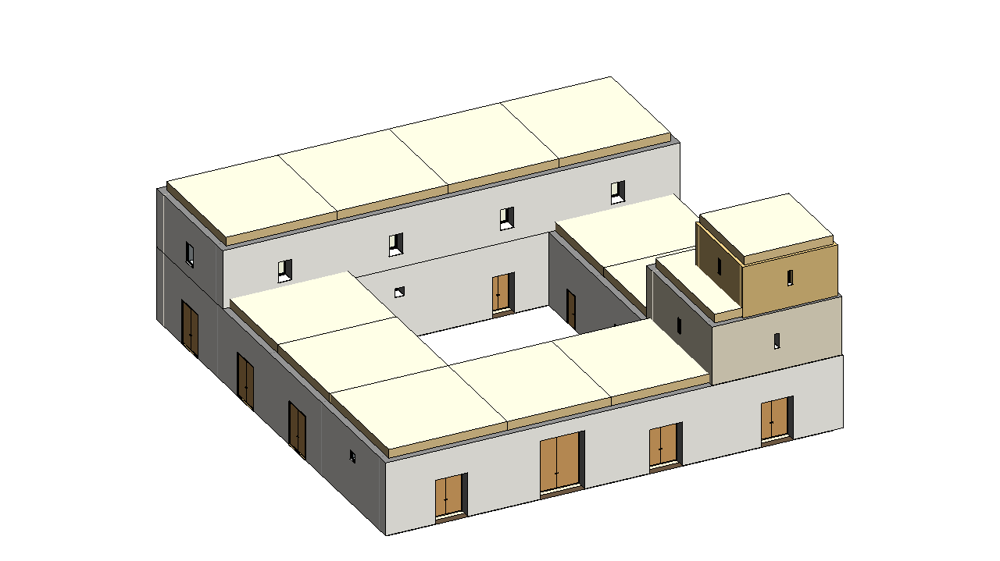

# Fortified Farmhouse - TBIM example project

An invented fortified farmhouse (*masseria*) of southern Italy, 18th century: a 30 x 30 m courtyard plan in tuff masonry with vaulted ground-floor wings (stables, oil mill, chapel, wine cellar, stores, granary, the farmer's house), the owner's house on the north wing and a defensive tower on the south-east corner, crowned by a dovecote turret. Flat roof terraces on the vaults; whitewashed walls, a limestone tower and an exposed-tuff dovecote.



The building was generated and run through the complete TBIM workflow automatically: it is one of the six
buildings of the [six-building video](../../docs/video/tbim_six_buildings.mp4).

## Model

| | |
|---|---|
| Cells (rooms) | 17 |
| Building storeys | 4 |
| Revit | 55 walls, 18 floors, 13 roofs, 17 spaces, 29 windows, 19 doors |
| Thermal zones | 10 |
| Occupancy types | Residential:Bedroom/LivingRoom/Kitchen/Dwelling, Agricultural:Stable/Storage/Granary/OilMill/WineCellar/Dovecote, Religious:Chapel, Circulation:Passage, Defensive:Tower |

## Constructions

Informational Rule Sets: each style is a layered Revit type whose materials (colour, conductivity, density, specific heat) come from the TBIM material library ([`lib/tbim/materials.py`](../../pyRevit/pyRevit_extensions/TBIM.extension/lib/tbim/materials.py)). Layers from the outside (top) to the inside (bottom), thicknesses in mm; U-values in W/(m2 K), computed from the layers (given for glazing).

| Element | Type | Layers | U |
|---|---|---|---|
| External walls | `TBIM_Whitewashed_Battered_Tuff_Wall_900` | Whitewashed lime render 20 / Tuff ashlar 860 / Lime plaster 20 | 0.63 |
| External walls (next to: Defensive) | `TBIM_Limestone_Tower_Wall_800` | Limestone ashlar 150 / Tuff ashlar 630 / Lime plaster 20 | 0.78 |
| External walls (next to: Dovecote) | `TBIM_Exposed_Tuff_Dovecote_Wall_400` | Exposed tuff ashlar 400 | 1.24 |
| Internal walls | `TBIM_Tuff_Masonry_Wall_500` | Lime plaster 20 / Tuff ashlar 460 / Lime plaster 20 | 0.95 |
| Ground floor | `TBIM_Limestone_Slab_Paving_300` | Limestone paving slabs 60 / Lime mortar bed 40 / Compacted earth 200 | 2.36 |
| Floors | `TBIM_Tuff_Star_Vault_600` | Limestone paving slabs 40 / Tuff rubble fill 260 / Tuff stone vault 300 | 0.74 |
| Flat roofs | `TBIM_Vaulted_Roof_Terrace_600` | Lime-tuff roof screed 50 / Tuff rubble fill 250 / Tuff stone vault 300 | 0.77 |

## Files

| | |
|---|---|
| `make_model.py` | Floor plans (rooms as boxes), ILDs, InstanceBIM data, IRSs, room table (`tbim_Rooms.json`) and window/door rules (`tbim_TopologicalBIM_Rules.json`): writes `3d/` and `json/` |
| `3d/*.brep` | Massing model, one CellComplex per building block (centimetres) |
| `json/` | TBIM data of every step of the workflow |
| `Fortified_Farmhouse.rvt` | Revit 2026 model at the end of the workflow, with the TBIM views and legends |
| `export/Fortified_Farmhouse.ifc` | IFC4 Reference View with the TBIM property sets (Export > IFC) |
| `export/tbim_InstanceBIM.*` | InstanceBIM as topologicpy JSON, BREP, OBJ, dual (adjacency) and passage graphs JSON (Export > Topologic) |

## Rebuild

```bat
python make_model.py
```

then open an empty Revit model, **Project > Open** this folder and press **Project > Run**: it runs every
step of the workflow, from Collectors to the exports (occupancy types from Loads > Assignment > From Table,
windows and doors from TopologicalBIM > By Rules). **Project > Check Model** checks the result.
