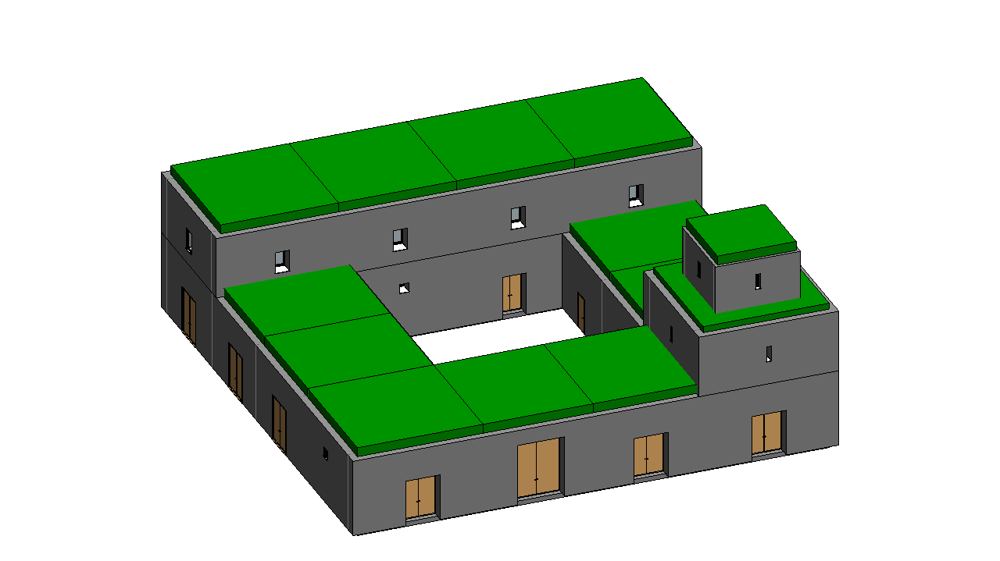

# Masseria - TBIM example project

An invented fortified farmhouse of southern Italy (18th century): a 30 x 30 m courtyard plan in tuff masonry with vaulted ground-floor wings (stables, oil mill, chapel, wine cellar, stores, granary, the farmer's house), the owner's house on the north wing and a defensive tower with a dovecote on the south-east corner. Flat roof terraces (lastrici solari).



The building was generated and run through the complete TBIM workflow automatically: it is one of the six
buildings of the [six-building video](../../docs/video/tbim_six_buildings.mp4).

## Model

| | |
|---|---|
| Cells (rooms) | 17 |
| Building storeys | 4 |
| Revit | 55 walls, 18 floors, 13 roofs, 17 spaces, 29 windows, 19 doors |
| Thermal zones | 10 |
| Occupancy types | Residential:Bedroom/LivingRoom/Kitchen/Dwelling, Agricultural:Stable/Storage/Granary/OilMill/WineCellar/Dovecote, Religious:Chapel, Circulation:Passage, Defensive:Tower |

## Files

| | |
|---|---|
| `make_model.py` | Floor plans (rooms as boxes), ILDs, InstanceBIM data, IRSs and window/door rules: writes `3d/` and `json/` |
| `3d/*.brep` | Massing model, one CellComplex per building block (centimetres) |
| `json/` | TBIM data of every step of the workflow |
| `Masseria.rvt` | Revit 2026 model at the end of the workflow, with the TBIM views and legends |
| `export/Masseria.ifc` | IFC4 Reference View with the TBIM property sets (Export > IFC) |
| `export/tbim_InstanceBIM.*` | InstanceBIM as topologicpy JSON, BREP, OBJ and dual graph JSON (Export > Topologic) |

## Rebuild

```bat
python make_model.py
```

then follow the [tutorial](../../docs/USER_MANUAL.md#4-tutorial-the-demo-school-step-by-step) on an empty Revit model
(**Project > Open** this folder). Windows and doors come from a stand-in of the TopologicalBIM panel:
`python tools/topologicalbim_standin.py projects/Masseria` (see [tools](../../tools)).
