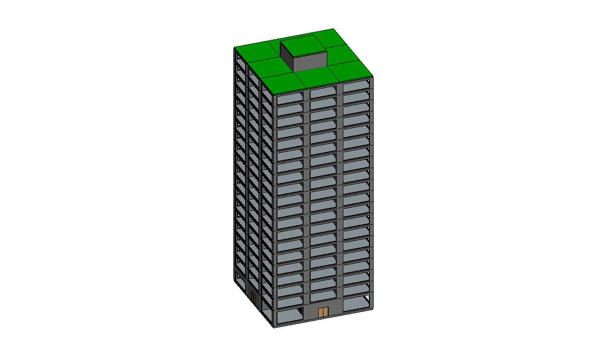

# Office Tower - TBIM example project

An invented 20-storey office tower: 30 x 30 m square plan with a central reinforced-concrete core (stairs, lifts, services) and a ring of eight office cells per storey, a double-height lobby with a cafe and shops at the ground floor and a plant room on the roof. Unitized curtain wall, post-tensioned slabs.



The building was generated and run through the complete TBIM workflow automatically: it is one of the six
buildings of the [six-building video](../../docs/video/tbim_six_buildings.mp4).

## Model

| | |
|---|---|
| Cells (rooms) | 181 |
| Building storeys | 22 |
| Revit | 484 walls, 181 floors, 9 roofs, 181 spaces, 236 windows, 244 doors |
| Thermal zones | 101 |
| Occupancy types | Office:OpenPlan, Office:Private, Office:MeetingRoom, Office:Reception, Circulation:Core, Circulation:Lobby, Food:Cafe, Retail:Shop, Technical:Plant |

## Files

| | |
|---|---|
| `make_model.py` | Floor plans (rooms as boxes), ILDs, InstanceBIM data, IRSs and window/door rules: writes `3d/` and `json/` |
| `3d/*.brep` | Massing model, one CellComplex per building block (centimetres) |
| `json/` | TBIM data of every step of the workflow |
| `Office_Tower.rvt` | Revit 2026 model at the end of the workflow, with the TBIM views and legends |
| `export/Office_Tower.ifc` | IFC4 Reference View with the TBIM property sets (Export > IFC) |
| `export/tbim_InstanceBIM.*` | InstanceBIM as topologicpy JSON, BREP, OBJ and dual graph JSON (Export > Topologic) |

## Rebuild

```bat
python make_model.py
```

then follow the [tutorial](../../docs/USER_MANUAL.md#4-tutorial-the-demo-school-step-by-step) on an empty Revit model
(**Project > Open** this folder). Windows and doors come from a stand-in of the TopologicalBIM panel:
`python tools/topologicalbim_standin.py projects/Office_Tower` (see [tools](../../tools)).
