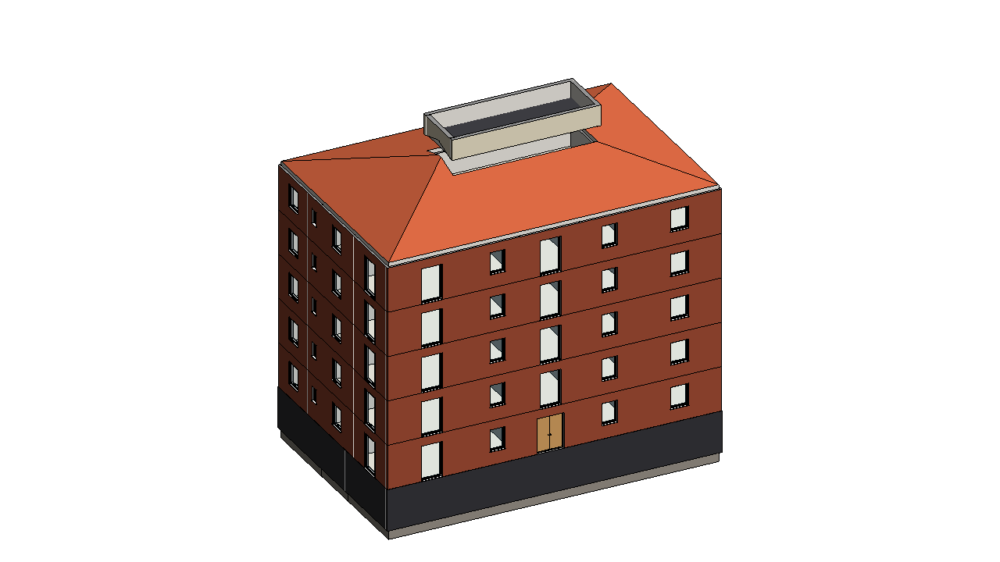
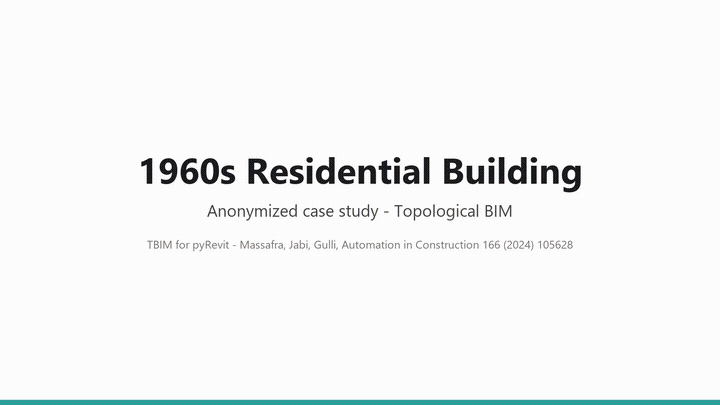

# Residential 1960s - TBIM case study

An existing multi-storey residential building of the mid 1960s in northern Italy, modelled with TBIM from the
archive drawings of its building permit (plans 1:100, elevations, section). The case study is **anonymized**:
address, owners, designers and permit references are omitted, and the model is a simplified reconstruction.





Video: [video/tbim_residential_1960s.mp4](video/tbim_residential_1960s.mp4)

## Model

| | |
|---|---|
| Footprint | 22.00 x 14.30 m, two flats per storey beside the central stair and lift |
| Storeys | basement (garages, boiler room) z 0-2.80 m; 5 residential storeys of 3.00 m (raised floor + 4 typical) |
| Roof | hipped, clay tiles, 30 % slope, attic not heated; stair turret up to z 20.80 m |
| Project North | 131 degrees |
| Cells | 112: 5 basement, 105 rooms (21 per storey, from the typical plan), attic, turret |
| Revit | 334 walls, 138 slabs, 5 roofs (4 pitches + turret), 112 spaces, 99 windows, 91 doors |

Construction typical of Italian 1960s condominiums: reinforced-concrete frame, brick cavity walls, clay-concrete
slabs, clay-tile roof, anodized aluminium windows with single glazing (U 5.8 W/(m2 K)).

## Constructions

Informational Rule Sets: each style is a layered Revit type whose materials (colour, conductivity, density, specific heat) come from [`tools/materials.py`](../../tools/materials.py). Layers from the outside (top) to the inside (bottom), thicknesses in mm; U-values in W/(m2 K), computed from the layers (given for glazing).

| Element | Type | Layers | U |
|---|---|---|---|
| External walls | `TBIM_Brick_Cavity_Wall_275` | Facing brick 120 / Air cavity 60 / Hollow clay brick 80 / Lime-cement plaster 15 | 1.38 |
| External walls (storey: z 0cm) | `TBIM_RC_Retaining_Wall_305` | Bitumen membrane 5 / Reinforced concrete 300 | 3.03 |
| External walls (storey: z 1780cm) | `TBIM_Rendered_Turret_Wall_280` | Cream cement render 15 / Hollow clay brick 250 / Lime-cement plaster 15 | 1.11 |
| Internal walls | `TBIM_Hollow_Brick_Partition_110` | Lime-cement plaster 15 / Hollow clay brick 80 / Lime-cement plaster 15 | 1.94 |
| Internal walls (next to: Stair) | `TBIM_Solid_Brick_Stairwell_Wall_280` | Lime-cement plaster 15 / Solid clay brick 250 / Lime-cement plaster 15 | 1.56 |
| Internal walls (storey: z 0cm) | `TBIM_RC_Basement_Wall_250` | Reinforced concrete 250 | 2.71 |
| Ground floor | `TBIM_RC_Basement_Slab_670` | Porcelain stoneware tiles 10 / Cement screed 60 / Reinforced concrete 300 / Lean concrete 100 / Gravel fill 200 | 1.76 |
| Floors | `TBIM_Clay_Concrete_Floor_315` | Marble-chip terrazzo tiles 20 / Cement screed 40 / Clay-concrete slab 240 / Lime-cement plaster 15 | 1.61 |
| Floors (next to: Parking) | `TBIM_RC_Floor_Over_Garage_295` | Marble-chip terrazzo tiles 20 / Cement screed 40 / Reinforced concrete 220 / Lime-cement plaster 15 | 2.82 |
| Floors (next to: Attic) | `TBIM_Attic_Floor_285` | Cement screed 30 / Clay-concrete slab 240 / Lime-cement plaster 15 | 1.66 |
| Flat roofs | `TBIM_Turret_Flat_Roof_303` | Bitumen membrane 8 / Cement screed 40 / Clay-concrete slab 240 / Lime-cement plaster 15 | 1.68 |
| Pitched roofs | `TBIM_Clay_Tile_Pitched_Roof_265` | Clay roof tiles 20 / Cement mortar bed 30 / Clay-concrete slab 200 / Lime-cement plaster 15 | 2.00 |

## Files

- `make_model.py`: BReps of the three blocks (Basement, Storeys = the residential storeys, Roof = attic and stair
  turret), room list (`json/rooms.json`), table of spaces.
- `make_rules.py`: ILDs (residential, 1960s: heated, naturally ventilated, not cooled), InstanceBIM data, IRSs,
  window/door rules of the TopologicalBIM stand-in.
- `json/`: TBIM data of every step; `3d/`: BReps; `img/`: the model in Revit.
- `Residential_1960s.rvt`: Revit 2026 model at the end of the workflow.
- `export/`: IFC4 with the TBIM property sets, InstanceBIM as topologicpy JSON, BREP, OBJ and dual graph.

To rebuild the inputs (Python 3.12 with the TBIM requirements):

```bat
python make_model.py
python make_rules.py
```

then open an empty Revit model, **Project > Open** this folder and run the TBIM workflow (see the
[user manual](../../docs/USER_MANUAL.md)). Windows and doors come from a stand-in of the TopologicalBIM panel:
`python tools/topologicalbim_standin.py projects/Residential_1960s`.

## Simplifications

- The raised floor uses the typical plan, with the entrance hall in place of the east living room.
- Balconies, eaves overhang, chimneys and the cellars below the basement are not modelled.
- Windows and doors come from a stand-in of the TopologicalBIM panel (rules by room type).
- Thermal zones follow the TBIM zoning rules: one heated zone per storey (central heating), stairs,
  garages and attic apart.
