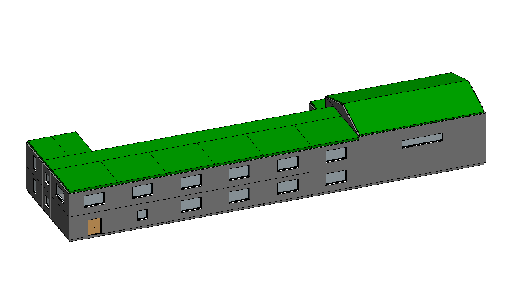

# School - TBIM example project

An invented two-storey school of the late 1970s: an L-shaped plan with a classroom wing (classrooms facing south along a corridor, stair and toilets behind it, entrance hall and administration on the ground floor, library and science lab upstairs) and a single-storey gym with changing rooms under a steel gable roof.



The building was generated and run through the complete TBIM workflow automatically: it is one of the six
buildings of the [six-building video](../../docs/video/tbim_six_buildings.mp4).

## Model

| | |
|---|---|
| Cells (rooms) | 23 |
| Building storeys | 4 |
| Revit | 74 walls, 23 floors, 14 roofs, 23 spaces, 29 windows, 25 doors |
| Thermal zones | 17 |
| Occupancy types | Education:Classroom, Education:Library, Education:Laboratory, Office:Administration, Circulation:EntranceHall, Circulation:Corridor, Circulation:Stair, Support:Restroom, Sports:Gym, Support:ChangingRoom, Storage:Equipment, Unconditioned:Attic |

## Constructions

Informational Rule Sets: each style is a layered Revit type whose materials (colour, conductivity, density, specific heat) come from the TBIM material library ([`lib/tbim/materials.py`](../../pyRevit/pyRevit_extensions/TBIM.extension/lib/tbim/materials.py)). Layers from the outside (top) to the inside (bottom), thicknesses in mm; U-values in W/(m2 K), computed from the layers (given for glazing).

| Element | Type | Layers | U |
|---|---|---|---|
| External walls | `TBIM_Insulated_Facing_Brick_Wall_355` | Facing brick 60 / EPS insulation 30 / Perforated clay brick 250 / Lime-cement plaster 15 | 0.51 |
| External walls (next to: Gym) | `TBIM_Precast_Sandwich_Panel_240` | Precast concrete 80 / EPS insulation 40 / Precast concrete 120 | 0.71 |
| Internal walls | `TBIM_Hollow_Brick_Partition_130` | Lime-cement plaster 15 / Hollow clay brick 100 / Lime-cement plaster 15 | 1.75 |
| Internal walls (next to: Corridor) | `TBIM_Corridor_Brick_Wall_250` | Lime-cement plaster 15 / Perforated clay brick 220 / Lime-cement plaster 15 | 0.97 |
| Internal walls (next to: Gym) | `TBIM_Gym_RC_Wall_300` | Reinforced concrete 300 | 2.56 |
| Ground floor | `TBIM_Ground_Slab_Crawl_Space_414` | Linoleum 4 / Cement screed 60 / Reinforced concrete 200 / Gravel fill 150 | 2.28 |
| Floors | `TBIM_Clay_Concrete_Floor_309` | Linoleum 4 / Cement screed 50 / Clay-concrete slab 240 / Lime-cement plaster 15 | 1.56 |
| Floors (next to: Attic) | `TBIM_Gym_Suspended_Ceiling_80` | Mineral wool 60 / Mineral fibre ceiling tiles 20 | 0.44 |
| Flat roofs | `TBIM_Flat_Roof_Cork_Insulated_333` | Bitumen membrane 8 / Cement screed 40 / Cork insulation 30 / Clay-concrete slab 240 / Lime-cement plaster 15 | 0.79 |
| Pitched roofs | `TBIM_Steel_Sheet_Gym_Roof_192` | Pre-painted corrugated steel sheet 2 / Mineral wool 40 / Steel trusses 150 | 0.78 |

## Files

| | |
|---|---|
| `make_model.py` | Floor plans (rooms as boxes), ILDs, InstanceBIM data, IRSs, room table (`tbim_Rooms.json`) and window/door rules (`tbim_TopologicalBIM_Rules.json`): writes `3d/` and `json/` |
| `3d/*.brep` | Massing model, one CellComplex per building block (centimetres) |
| `json/` | TBIM data of every step of the workflow |
| `School.rvt` | Revit 2026 model at the end of the workflow, with the TBIM views and legends |
| `export/School.ifc` | IFC4 Reference View with the TBIM property sets (Export > IFC) |
| `export/tbim_InstanceBIM.*` | InstanceBIM as topologicpy JSON, BREP, OBJ, dual (adjacency) and passage graphs JSON (Export > Topologic) |

## Rebuild

```bat
python make_model.py
```

then open an empty Revit model, **Project > Open** this folder and press **Project > Run**: it runs every
step of the workflow, from Collectors to the exports (occupancy types from Loads > Assignment > From Table,
windows and doors from TopologicalBIM > By Rules). **Project > Check Model** checks the result.
