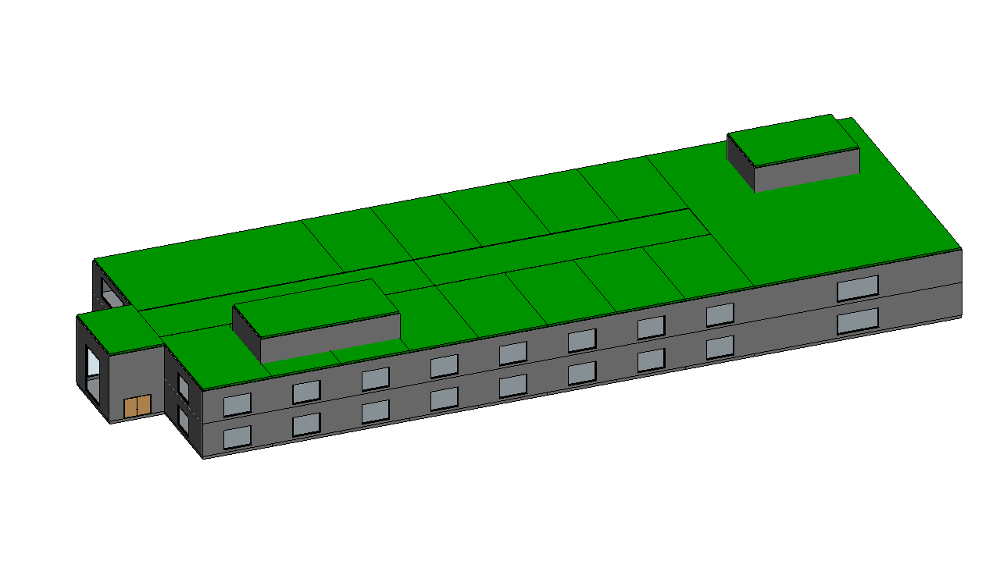

# Shopping Centre - TBIM example project

An invented two-level shopping centre: an 80 m long double-height glazed gallery with two levels of shops on both sides, a food court on the upper level, a two-level department store at the east end, an entrance hall at the west end and two plant rooms on the roof. Precast structure, insulated metal panels.



The building was generated and run through the complete TBIM workflow automatically: it is one of the six
buildings of the [six-building video](../../docs/video/tbim_six_buildings.mp4).

## Model

| | |
|---|---|
| Cells (rooms) | 37 |
| Building storeys | 4 |
| Revit | 119 walls, 40 floors, 22 roofs, 37 spaces, 41 windows, 35 doors |
| Thermal zones | 10 |
| Occupancy types | Retail:Shop, Retail:DepartmentStore, Food:FoodCourt, Circulation:Gallery, Circulation:EntranceHall, Technical:Plant |

## Constructions

Informational Rule Sets: each style is a layered Revit type whose materials (colour, conductivity, density, specific heat) come from the TBIM material library ([`lib/tbim/materials.py`](../../pyRevit/pyRevit_extensions/TBIM.extension/lib/tbim/materials.py)). Layers from the outside (top) to the inside (bottom), thicknesses in mm; U-values in W/(m2 K), computed from the layers (given for glazing).

| Element | Type | Layers | U |
|---|---|---|---|
| External walls | `TBIM_Ventilated_Metal_Facade_294` | Aluminium composite panel 4 / Ventilated air cavity 40 / Mineral wool 100 / Precast concrete 150 | 0.32 |
| External walls (next to: DepartmentStore) | `TBIM_Terracotta_Rainscreen_Facade_340` | Terracotta rainscreen tiles 30 / Ventilated air cavity 40 / Mineral wool 120 / Precast concrete 150 | 0.27 |
| Internal walls | `TBIM_Fire_Rated_Partition_EI60_150` | Fire-rated gypsum board 25 / Mineral wool 100 / Fire-rated gypsum board 25 | 0.30 |
| Internal walls (next to: Gallery) | `TBIM_Glazed_Shop_Front_24` | Laminated safety glass 24 | 2.80 |
| Ground floor | `TBIM_Insulated_Ground_Slab_572` | Porcelain stoneware tiles 12 / Cement screed 60 / EPS insulation 100 / Reinforced concrete 300 / Lean concrete 100 | 0.30 |
| Floors | `TBIM_Hollow_Core_Floor_372` | Porcelain stoneware tiles 12 / Cement screed 60 / Precast hollow-core slab 300 | 1.99 |
| Flat roofs | `TBIM_Standing_Seam_Roof_362` | Standing-seam aluminium sheet 2 / Mineral wool 160 / Precast hollow-core slab 200 | 0.20 |
| Flat roofs (next to: Gallery) | `TBIM_Gallery_Skylight_44` | Laminated double glazing 44 | 1.40 |

## Files

| | |
|---|---|
| `make_model.py` | Floor plans (rooms as boxes), ILDs, InstanceBIM data, IRSs, room table (`tbim_Rooms.json`) and window/door rules (`tbim_TopologicalBIM_Rules.json`): writes `3d/` and `json/` |
| `3d/*.brep` | Massing model, one CellComplex per building block (centimetres) |
| `json/` | TBIM data of every step of the workflow |
| `Shopping_Centre.rvt` | Revit 2026 model at the end of the workflow, with the TBIM views and legends |
| `export/Shopping_Centre.ifc` | IFC4 Reference View with the TBIM property sets (Export > IFC) |
| `export/tbim_InstanceBIM.*` | InstanceBIM as topologicpy JSON, BREP, OBJ, dual (adjacency) and passage graphs JSON (Export > Topologic) |

## Rebuild

```bat
python make_model.py
```

then open an empty Revit model, **Project > Open** this folder and press **Project > Run**: it runs every
step of the workflow, from Collectors to the exports (occupancy types from Loads > Assignment > From Table,
windows and doors from TopologicalBIM > By Rules). **Project > Check Model** checks the result.
