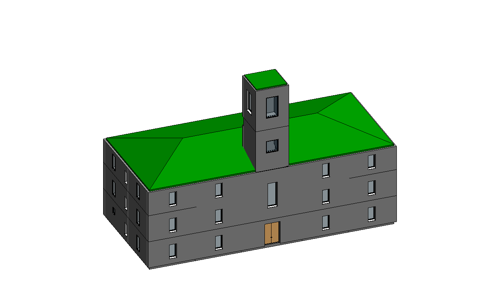

# Town Hall - TBIM example project

An invented early-20th-century town hall: a 40 x 18 m plan with offices on both sides of a central block (entrance hall on the ground floor, a double-height council chamber above it), corridors along the back, a hipped clay-tile roof and a clock tower with a belfry on the front. Brick masonry, steel-beam and brick-vault slabs.



The building was generated and run through the complete TBIM workflow automatically: it is one of the six
buildings of the [six-building video](../../docs/video/tbim_six_buildings.mp4).

## Model

| | |
|---|---|
| Cells (rooms) | 35 |
| Building storeys | 6 |
| Revit | 111 walls, 45 floors, 5 roofs, 35 spaces, 51 windows, 31 doors |
| Thermal zones | 22 |
| Occupancy types | Office:PublicDesk, Office:Registry, Office:Private, Office:Administration, Archive:Records, Circulation:Corridor, Circulation:EntranceHall, Assembly:CouncilChamber, Unconditioned:Attic, Civic:ClockTower, Civic:Belfry |

## Constructions

Informational Rule Sets: each style is a layered Revit type whose materials (colour, conductivity, density, specific heat) come from the TBIM material library ([`lib/tbim/materials.py`](../../pyRevit/pyRevit_extensions/TBIM.extension/lib/tbim/materials.py)). Layers from the outside (top) to the inside (bottom), thicknesses in mm; U-values in W/(m2 K), computed from the layers (given for glazing).

| Element | Type | Layers | U |
|---|---|---|---|
| External walls | `TBIM_Rendered_Solid_Brick_Wall_600` | Rusticated lime render 30 / Solid clay brick 550 / Lime plaster 20 | 1.00 |
| External walls (next to: Civic) | `TBIM_Exposed_Brick_Tower_Wall_450` | Exposed solid brick 120 / Solid clay brick 330 | 1.28 |
| Internal walls | `TBIM_Solid_Brick_Partition_150` | Lime plaster 15 / Solid clay brick 120 / Lime plaster 15 | 2.13 |
| Internal walls (next to: Corridor) | `TBIM_Solid_Brick_Spine_Wall_460` | Lime plaster 20 / Solid clay brick 420 / Lime plaster 20 | 1.11 |
| Ground floor | `TBIM_Ventilated_Crawl_Space_Floor_450` | Venetian terrazzo 30 / Lime screed 60 / Solid brick jack-arch slab 120 / Air cavity 240 | 0.85 |
| Floors | `TBIM_Steel_Jack_Arch_Floor_315` | Venetian terrazzo 30 / Lime screed 50 / Solid brick jack-arch slab 220 / Lime plaster 15 | 1.75 |
| Floors (next to: Attic) | `TBIM_Timber_Attic_Floor_250` | Timber floorboards 25 / Timber beams 200 / Reed-and-plaster ceiling 25 | 0.50 |
| Flat roofs | `TBIM_Lead_Tower_Roof_208` | Lead sheet 3 / Timber boarding 25 / Timber beams 180 | 0.58 |
| Pitched roofs | `TBIM_Clay_Tile_Timber_Roof_275` | Clay roof tiles 20 / Timber battens 30 / Timber boarding 25 / Timber rafters 200 | 0.47 |

## Files

| | |
|---|---|
| `make_model.py` | Floor plans (rooms as boxes), ILDs, InstanceBIM data, IRSs, room table (`tbim_Rooms.json`) and window/door rules (`tbim_TopologicalBIM_Rules.json`): writes `3d/` and `json/` |
| `3d/*.brep` | Massing model, one CellComplex per building block (centimetres) |
| `json/` | TBIM data of every step of the workflow |
| `Town_Hall.rvt` | Revit 2026 model at the end of the workflow, with the TBIM views and legends |
| `export/Town_Hall.ifc` | IFC4 Reference View with the TBIM property sets (Export > IFC) |
| `export/tbim_InstanceBIM.*` | InstanceBIM as topologicpy JSON, BREP, OBJ, dual (adjacency) and passage graphs JSON (Export > Topologic) |

## Rebuild

```bat
python make_model.py
```

then open an empty Revit model, **Project > Open** this folder and press **Project > Run**: it runs every
step of the workflow, from Collectors to the exports (occupancy types from Loads > Assignment > From Table,
windows and doors from TopologicalBIM > By Rules). **Project > Check Model** checks the result.
